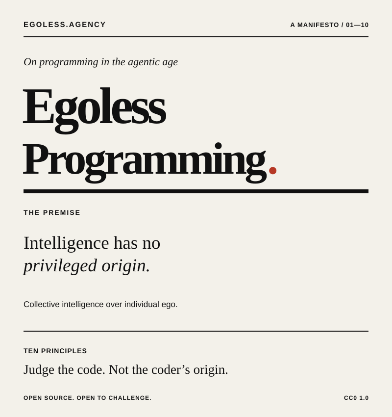

    A manifesto for collective intelligence over individual ego. Its ten principles hold human and artificial
        contributors to the same standards of evidence, review, and respect.

    <strong><a href="https://egoless.agency/">Read the manifesto →</a></strong>

    The manifesto and site are dedicated to the public domain under <a href="LICENSE">CC0 1.0 Universal</a>.

